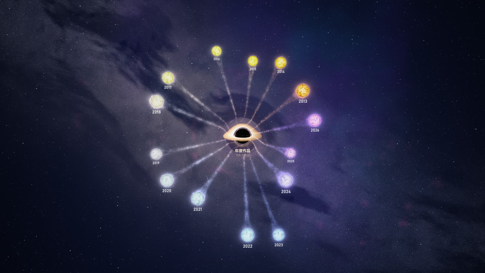
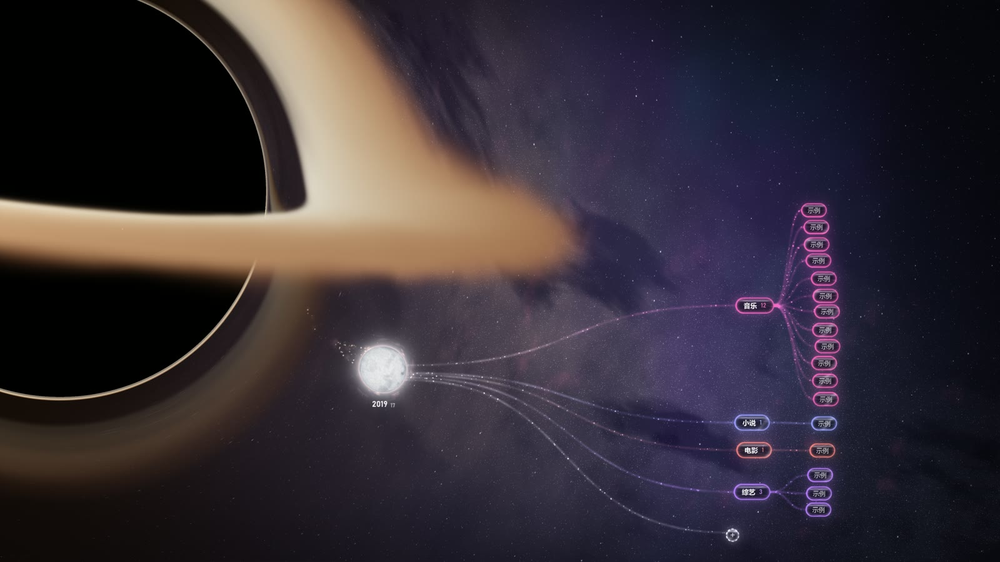

# 年度作品

记录每年喜欢的作品，画成一张会动的星图。Windows 桌面程序，记录只存在自己电脑上，不联网、不上传。

中间是黑洞，每一年是一颗恒星，点恒星展开这一年的分类和作品；整张图用显卡着色器实时渲染。





## 功能

- **按年份记录「年度作品」**：文学作品 / 音乐 / 小说 / 电视剧 / 电影 / 动漫 / 综艺 / 鬼畜/梗 / 游戏
- **每个作品**：名字、作者（歌手 / 作者）、10 星评分、短评、封面（拖图片进去或 Ctrl+V 粘贴截图），鼠标放在作品上显示封面
- **星图**：
  - 光线追踪的黑洞（吸积盘、光子环、背景星空的引力透镜）
  - 恒星表面翻涌，物质流从恒星流进黑洞
  - 分类和作品是半透明黑水晶胶囊，收起时碎成晶尘
  - 点黑洞，所有恒星碎成颗粒被吸进去；再点一次从黑洞里喷出来，重新凝成恒星
  - 全图里可以拖动恒星，拖到黑洞跟前松手会单独收进去
- **从 MarginNote 3 导入**：以前用 MarginNote 做过「每年看过的作品」思维导图的，可以「导出到 OmniOutliner」后导入（也支持 OPML）

## 下载使用（不用装 Python）

1. 到 [Releases](../../releases) 下载最新的 `yearly-works-v<版本>.zip`，解压到任意文件夹
2. 双击 `年度作品.exe`
3. 右上角「添加年份」先建一年，点那颗恒星展开，点「＋」或右键恒星添加作品；点作品编辑，右键删除

### 说明

- 记录存在 exe 旁边的 `data` 文件夹里；换电脑或升级新版时，把 `data` 拷过去就行
- 需要支持 OpenGL 3.3 的显卡；画面比较吃显卡，笔记本接上电源、用独立显卡会更流畅
- 出错时 exe 旁边会生成 `log.txt`

## 从源码运行

Windows，开发和测试用的是 Python 3.14。

```bash
python -m venv .venv
.venv\Scripts\pip install -r requirements.txt
.venv\Scripts\python app.py
```

### 自己打包 exe

```bash
.venv\Scripts\pip install pyinstaller
.venv\Scripts\python build.py
```

生成 `dist\年度作品\`（双击里面的 `年度作品.exe`）和压缩包 `dist\yearly-works-v<版本>.zip`。只打包代码和图标，`data\`、`settings.json` 等个人数据不会进去。

## 代码结构

| 文件 | 作用 |
| --- | --- |
| `app.py` | 主窗口：星图铺满窗口，右上角导入 / 添加年份，编辑对话框的调度 |
| `mindmap.py` | 星图：布局、动画、鼠标交互，用 moderngl 在 QOpenGLWidget 里渲染 |
| `shaders.py` | 所有着色器：星空、黑洞光线追踪、恒星、胶囊、文字、辉光和收尾 |
| `stream.py` | 恒星流向黑洞的物质流（显卡粒子，transform feedback） |
| `shards.py` | 恒星解体 / 重新凝结的气体和碎片（显卡上模拟引力） |
| `widgets.py` | 评分、封面框、作品编辑对话框、悬停封面卡片 |
| `store.py` | 本地数据 `data/作品.json` 和封面 `data/封面/` |
| `marginnote.py` | 解析 MarginNote 导出的 OmniOutliner XML / OPML |
| `fluent_ui.py` | Win11 风格窗口（Mica 背景）、单实例 |
| `build.py` | PyInstaller 打包 |
